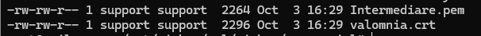
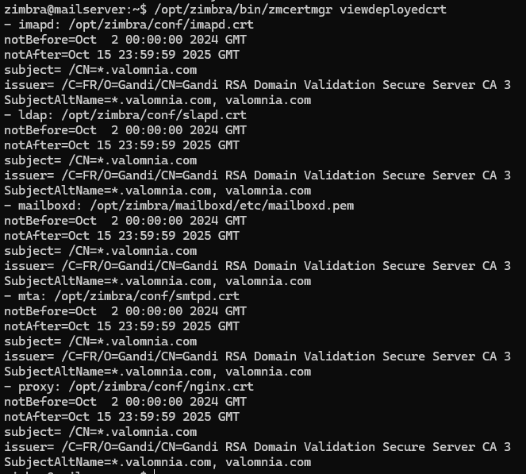
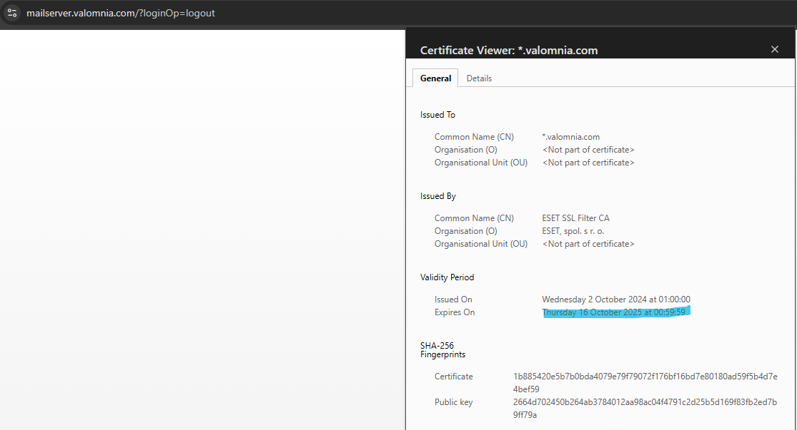

# Renew a Zimbra Mail Server SSL certificate

## Introduction

Renewing the SSL certificate for your Zimbra Mail Server is essential for maintaining secure email communications. This guide outlines the steps to efficiently renew your SSL certificate, ensuring uninterrupted service and data protection.

## SSH Connection to the Zimbra Server
Make sure you are logged in as the root user or with sufficient privileges to manage Zimbra

`ssh  support@ip`
## Downloading Certificate Files

Download the files from the Gandi interface to your computer, then transfer them to your Zimbra server via SCP

`scp /path/to/your/cert.crt support@ip:/home/support`

`scp /path/to/your/intermediate.pem support@ip:/home/support`

Then, move the certificate and the intermediate file to `/opt/zimbra/ssl/zimbra/commercial/`

`mv Intermediare.pem /opt/zimbra/ssl/zimbra/commercial/`

`mv valomnia.crt /opt/zimbra/ssl/zimbra/commercial/`

## Installing the Certificate on Zimbra

Once you have obtained the certificate signed by Gandi and the intermediate chain , you can now install the certificate on Zimbra.

 * Go to the commercial directory of Zimbra

` cd /opt/zimbra/ssl/zimbra/commercial/`

* Combine the intermediate certificate chain and the final certificate into a single file

`cat cert.crt Intermediare.pem > commercial2025.crt`

* Install the new certificate

`/opt/zimbra/bin/zmcertmgr deploycrt comm /opt/zimbra/ssl/zimbra/commercial/commercial2025.crt /opt/zimbra/ssl/zimbra/commercial/commercial_ca.crt`

**commercial2025.crt** is the certificate signed by Gandi.
**commercial_ca.crt** is the intermediate certificate chain.

* Verify that the certificate has been installed correctly

`/opt/zimbra/bin/zmcertmgr viewdeployedcrt`

## Redémarrer Zimbra
Restart the Zimbra services to apply the new SSL certificate.

`zmcontrol restart`

## Verification of the installation

Once Zimbra has restarted, check that the certificate is working correctly by accessing your mail server via HTTPS at https://mailserver.valomnia.com/

## Conclusion
In summary, renewing the SSL certificate for your Zimbra Mail Server is a straightforward process that enhances security and ensures uninterrupted email services. By following the outlined steps, you can successfully install and verify the new certificate, maintaining the integrity of your communications.
